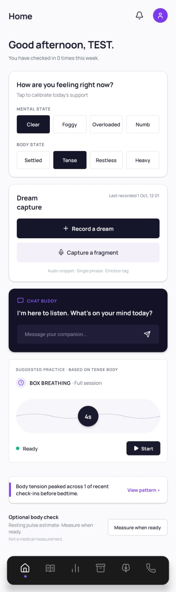
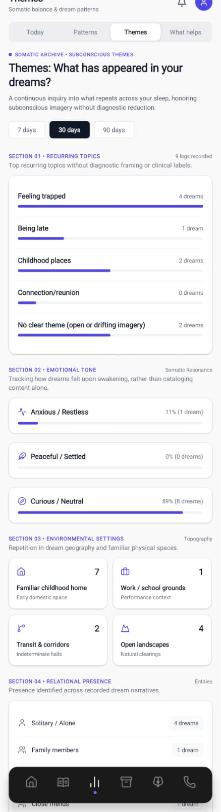
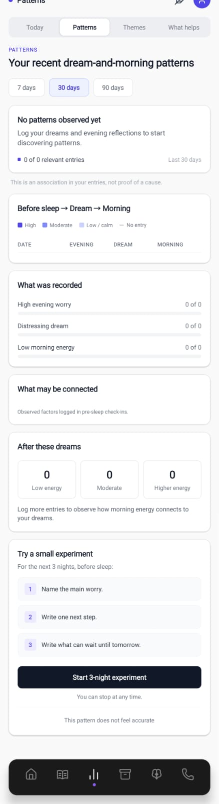
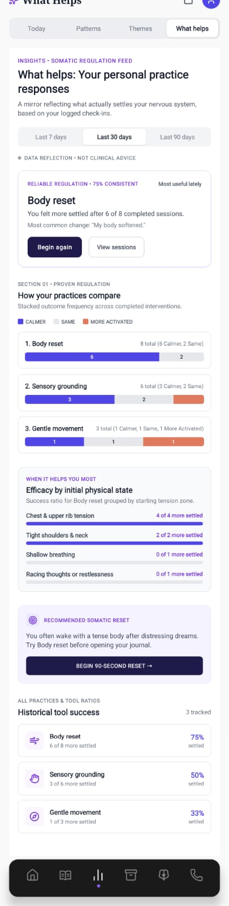
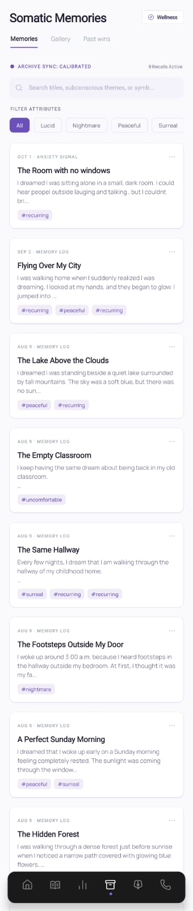
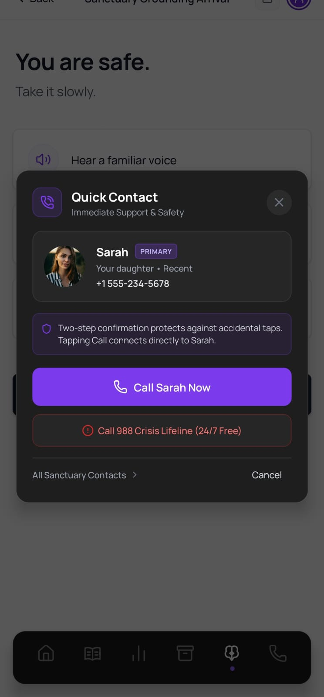

# Lucid Dreams - Dream Journal and Mental Wellness Platform

Lucid Dreams is an AI-powered dream journaling, mental health monitoring, and biometric grounding application. The platform provides dream logging with cognitive behavioral insights, photoplethysmography (PPG) heart-rate monitoring through the smartphone camera, auditory grounding exercises, and safety resources for dementia and sundowning support.

---

## Application Preview

| Home Dashboard | Dream & Theme Insights | Emotional Trends |
| :---: | :---: | :---: |
|  |  |  |

| Adaptive Coping | Sanctuary & Memory Support | Emergency Safety & Dial Guard |
| :---: | :---: | :---: |
|  |  |  |

<!-- Reserved slot for Heart Rate PPG screen: docs/screenshots/07_heart_rate_ppg.jpeg -->

---

## Architecture Overview

The system consists of two primary subsystems:
1. **Frontend Client (`lucid-dreams-app`)**: A cross-platform mobile application built with React Native and Expo (SDK 54), targeting Android and iOS, with native Kotlin integrations for real-time video processing.
2. **Backend API (`lucid-dreams-backend`)**: A RESTful microservice built with Node.js and Express 5, connecting to MongoDB Atlas for persistence and interfacing with Google Gemini and OpenAI models.

---

## Tech Stack and Languages Used

### Programming Languages
- **TypeScript / JavaScript**: Primary frontend language for UI components, navigation, animations, and state management.
- **JavaScript (Node.js ES6+)**: Backend service logic, route handling, authentication middleware, and database operations.
- **Kotlin**: Native Android integration (`HeartRatePlugin.kt`). Utilized for low-level camera frame analysis and real-time photoplethysmography (PPG) pulse extraction.

### Frontend (`lucid-dreams-app`)
- **Framework**: React Native 0.81, Expo SDK 54, React 19
- **Navigation**: Expo Router (file-based routing with tab and modal layouts)
- **Camera and Computer Vision**: React Native Vision Camera v4, React Native Worklets Core
- **Animation and Gestures**: React Native Reanimated v4, React Native Gesture Handler
- **Data Visualization**: React Native Gifted Charts, React Native SVG
- **Audio Processing**: Expo AV
- **Authentication**: React Native Auth0, Expo SecureStore

### Backend (`lucid-dreams-backend`)
- **Runtime**: Node.js
- **Web Framework**: Express 5
- **Database**: MongoDB Atlas via Mongoose ORM
- **Artificial Intelligence**:
  - Google Gemini API (`@google/genai`, `@google/generative-ai`): Dream interpretation, emotional analysis, and cognitive reframing suggestions.
  - OpenAI API (`openai`): Audio transcription and conversational reflections.
- **Security and Authentication**: JSON Web Tokens (JWT), Bcrypt, Express Rate Limit, Auth0 JWT Bearer validation
- **Image Processing**: Sharp

---

## Native Kotlin Integration: What is Kotlin Used For?

In the mobile client, pure JavaScript cannot process 30 frames per second directly from the camera sensor without dropping frames and causing high battery drain.

Kotlin is used in `HeartRatePlugin.kt` as a custom **Vision Camera Frame Processor Plugin**:
1. **Photoplethysmography (PPG) Signal Extraction**: Accesses raw camera sensor frames (YUV/RGBA buffers) via Android media APIs as the user places their fingertip over the camera lens and flashlight.
2. **Real-Time Channel Averaging**: Analyzes average red channel luminosity across a rolling 45-frame buffer.
3. **Detrending and Baseline Drift Removal**: Implements a 30-frame running DC baseline subtraction to isolate the alternating AC heart pulse waveform from skin temperature and motion drift.
4. **Physiological Signal Filtering**: Applies peak detection and RR-interval anomaly rejection (filtering out intervals under 400ms or over 1500ms) to calculate real-time beats per minute (BPM) with high confidence.

---

## Key Features

- **Dream Journaling**: Structured capture of dream narratives, clarity levels, lucid dream indicators, and emotional valence.
- **AI Dream Analysis**: Automated sentiment parsing, recurring theme detection, and cognitive pattern recognition using Gemini and OpenAI.
- **Camera-Based Heart Rate Tracking**: Contact-based PPG pulse detection running on-device with zero peripheral hardware required.
- **Sanctuary and Sundowning Grounding**: Sensory stabilization screens featuring familiar voice notes, photo reassurance albums, calming soundscapes, and emergency contact dial guards.
- **Cognitive Behavioral Exercises**: Mood check-ins, box breathing guides, and coping card recommendations.

---

## Project Structure

```
Lucid_Dreams_Website/
├── docs/screenshots/               # Showcase screenshots for documentation
├── lucid-dreams-app/               # React Native (Expo) mobile frontend
│   ├── android/                    # Android project files and native Kotlin code
│   │   └── app/src/main/java/com/anonymous/luciddreamsapp/
│   │       ├── HeartRatePlugin.kt  # Native Kotlin PPG heart rate detection
│   │       ├── MainActivity.kt
│   │       └── MainApplication.kt
│   ├── app/                        # Expo Router screen definitions
│   │   ├── (auth)/                 # Authentication views
│   │   ├── (tabs)/                 # Main bottom-tab navigation screens
│   │   └── memory-support/         # Sanctuary grounding and caregiver screens
│   ├── components/                 # Reusable UI components
│   ├── context/                    # React Context providers (Auth, Sanctuary, etc.)
│   ├── utils/                      # Network utilities and persistent storage
│   └── .env.example                # Frontend environment template
│
├── lucid-dreams-backend/           # Node.js Express backend
│   ├── models/                     # Mongoose schemas (Dream, User, Sanctuary, etc.)
│   ├── routes/                     # REST API endpoints
│   ├── uploads/                    # Local media and photo storage
│   ├── server.js                   # Main application entrypoint
│   └── .env.example                # Backend environment template
│
└── .gitignore                      # Git exclusion rules for secrets and builds
```

---

## Local Setup and Installation

### Prerequisites
- Node.js (version 18 or higher)
- npm or yarn
- Android Studio and Android SDK (for physical device or emulator execution)
- MongoDB instance (local or Atlas)

### 1. Backend Setup
1. Navigate to the backend directory:
   ```bash
   cd lucid-dreams-backend
   ```
2. Install dependencies:
   ```bash
   npm install
   ```
3. Create your environment configuration file:
   ```bash
   cp .env.example .env
   ```
4. Update the values in `.env` with your MongoDB URI, API keys, and secrets.
5. Start the backend development server:
   ```bash
   npm run dev
   ```

### 2. Frontend Setup
1. Navigate to the frontend directory:
   ```bash
   cd ../lucid-dreams-app
   ```
2. Install dependencies:
   ```bash
   npm install
   ```
3. Create your environment configuration file:
   ```bash
   cp .env.example .env
   ```
4. Update `EXPO_PUBLIC_API_URL` to point to your backend IP or localhost.
5. If running on a physical Android device connected via USB:
   ```bash
   npm run reverse
   ```
6. Start the mobile app:
   ```bash
   npm run android
   ```

---

## License

This project is licensed under the ISC License.
